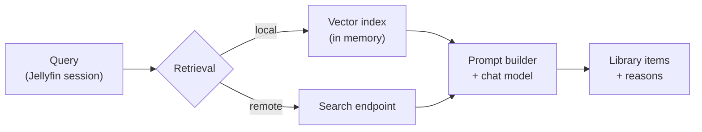

# AI Search for Jellyfin

Describe what you want to watch, and the plugin searches your Jellyfin library for a match.
It finds relevant titles, then asks a language model to pick the best ones and explain each choice.

`Jellyfin 10.11` · `.NET 9` · `no database` · `any OpenAI-compatible endpoint` · `runs fully offline with Ollama`

```
"something tense and short for tonight, like Sicario"
"films about Native Americans"
"a movie with both DiCaprio and Brad Pitt"
"the Game of Thrones episode with a wedding"
```


---

## Why an index

The first version of this plugin sent a list of titles to the model and asked it to choose. That
limits what it can find. If you have 3000 movies but only send the 300 top-rated titles, the model
never gets a chance to recommend the other 2700.

The plugin now builds an index that lets it search by meaning. An embedding model converts each
title's metadata into numbers that can be compared with your query. The plugin searches the whole
index and sends the closest 40 matches to the language model, along with their cast and synopsis.
That gives the model enough context to make useful choices.

## Pipeline



1. The injected client script calls the plugin with the user's existing Jellyfin session. No API
   key and no endpoint URL reach the browser.
2. The plugin collects the titles the user can access, along with their watch history and
   favorites. Jellyfin's per-user access restrictions apply here.
3. The local index or a remote search service returns the closest matches.
4. The plugin removes titles the user cannot access, titles already shown, and watched titles
   unless the user has chosen to include them.
5. The prompt builder writes one line per candidate: `index | title (year) | genres | cast | synopsis`.
6. The model answers with strict JSON and selects candidates **by index only**. It cannot return a
   title that you do not own.
7. The plugin maps the indices back to Jellyfin items and returns posters, titles, years and reasons.

If the index or search service is unavailable, the plugin sends a selection from the library
instead. If the model rejects `response_format`, it retries without that option. It also handles
JSON replies wrapped in Markdown code fences.

## Design decisions

| Decision | Reason |
|---|---|
| Brute-force scan, no vector database | Searching 18000 vectors with 1024 dimensions takes milliseconds. At this library size, a separate database would add setup and maintenance without much benefit. |
| Plain float loop, no SIMD package | The scan is already fast enough. Keeping dependencies simple makes the plugin easier to run across Jellyfin platforms. |
| Vectors normalized once, at index time | Cosine similarity becomes a dot product. The query path does no division. |
| One binary file in Jellyfin's data folder | The index loads at startup and survives a restart. Restarting does not require rebuilding the embeddings. |
| Immutable snapshot, swapped atomically | A rebuild replaces one reference. Searches keep using the previous index until the new one is ready. |
| SHA-256 content hash per document | The nightly build re-embeds only the titles whose metadata changed. If nothing changed, no new embeddings are needed. |
| The hash covers the model id and the prefix | Change the embedding model and every vector is invalidated on the next build. Vectors from two models cannot mix. |
| The model selects by index | The model cannot invent a title. It also cannot return a title the user is not allowed to see, because the candidate list is built from that user's own item list. |
| Retrieval failure falls back to a catalog slice | If the index or embedding service is unavailable, the model can still choose from a smaller selection of library titles. |

**Index file format (v1):**

```
"AISEARCH" | version | model | built-at ticks | dimensions | count
then per entry: item GUID (16 B) | content hash | float32 × dimensions
```

The file is written to a temporary path and renamed, so an interrupted save cannot corrupt the
current index.

## Measured on a real library

3000 movies and 15000 episodes, mostly with French metadata.

| | |
|---|---|
| Index size | about 100 MB, one file |
| Query time | milliseconds in memory. Most of the wait is for the embedding service |
| First build, Ollama + bge-m3 on CPU | about 40 minutes |
| First build, OpenAI `text-embedding-3-small` | a few minutes, about $0.05 |
| Nightly incremental build | about 1 minute, usually 0 re-embeds |
| Tokens per search | about 7000 input, for 40 candidates with synopsis |
| Cost per search, `mistral-medium` | about $0.01 |
| Cost per search, local Ollama | none |

## Features

| Feature | What it does |
|---|---|
| **Search** | Free-text query. Matches on mood, theme, plot, cast or director. |
| **Surprise me** | No query. The plugin sends the model a random slice of the library. With personalization enabled, it also uses your favorites and history to guide the picks. Useful for finding something you would not think to search for. |
| **Help me choose** | The model uses what you have typed to ask 2 or 3 multiple-choice questions and narrow down the search. Your answers go back into the search. With an empty box you receive generic questions on mood, length and watch state. |
| **Create collection** | Saves the result set as a Jellyfin playlist. Any result set can also be saved after the fact. |
| **History** | The last 12 searches per user, stored server-side. Reopen the results or replay the search. |
| **Movies / TV switch** | Searches series *and* individual episodes. If the query names a series you own, the scan is restricted to that series. |
| **Personalize** | Feeds favorites, watch history and a taste profile into the prompt. Turn it off for a neutral search. |
| **Taste profile** | The model summarizes your favorites and history in 2 to 4 sentences. The profile refreshes in the background after 7 days or when your viewing preferences change. It is stored on your server and sent only to the backend you configured. |
| **Retrieval only** | Turn the language model off. The plugin then returns the retrieval matches ranked by similarity, without explanations or a chat model call. Embedding costs still depend on your provider. |

Answers follow the web client language. French and English are detected and passed to the model.

## Install

Add the repository in **Dashboard → Plugins → Repositories**:

```
https://raw.githubusercontent.com/Franciskid/jellyfin-plugin-ai-search/main/manifest.json
```

Install **AI Search** from the catalog, restart Jellyfin, then open **Dashboard → Plugins → AI Search**.

## Configure

Choose a chat service to make recommendations and a search source to find matching titles.

### Fully local, with Ollama

```
Chat endpoint URL:    http://<ollama-host>:11434/v1/chat/completions
Chat API key:         (empty)
Models endpoint URL:  http://<ollama-host>:11434/v1/models
Model:                any chat model from the dropdown
Retrieval:            Local index
Embeddings endpoint:  http://<ollama-host>:11434/v1/embeddings
Embedding model:      bge-m3          (run "ollama pull bge-m3" first)
```

Save, then click **Build index now**. Nothing leaves your network.

### OpenAI

```
Chat endpoint URL:    https://api.openai.com/v1/chat/completions
Chat API key:         sk-...
Models endpoint URL:  https://api.openai.com/v1/models
Model:                gpt-4o-mini
Retrieval:            Local index
Embeddings endpoint:  https://api.openai.com/v1/embeddings
Embedding model:      text-embedding-3-small
```

OpenAI receives title metadata when the index is built. During a search, it also receives your
query and the metadata of the selected candidates, plus favorites and history if personalization
is enabled.

### Chat-only providers

If your chat provider does not offer embeddings, you can use a local Ollama instance for those.
Set the chat endpoint to your provider and the embeddings endpoint to Ollama. The chat provider
still receives your search prompt and candidate metadata.

### Remote retrieval

```
Chat endpoint URL:    https://ai.your-service.example/api/media/chat
Models endpoint URL:  https://ai.your-service.example/api/media/models
Retrieval:            Remote service
Search endpoint URL:  https://ai.your-service.example/api/media/search
Search API key:       (issued by your service)
```

The service maintains the index and returns matching titles. The plugin then calls the language
model and checks the results against the user's library. Use this when a service already indexes your library, or
when you need to cap usage per user centrally. The contract is at the bottom of this file.

### Which embedding model

- **Multilingual libraries:** `bge-m3` on Ollama, about 1.2 GB. Multilingual, no prefix configuration.
- **English only, hosted:** `text-embedding-3-small`. A low-cost hosted option.
- **`nomic-embed-text`:** works, but you must fill in the prefixes on the config page: query prefix
  `search_query: ` and document prefix `search_document: `. Missing prefixes can lead to poor results without an error message.

## Options

**Language model**

| Option | Effect |
|---|---|
| Enable AI search | Turns the feature on or off. Turning it off also hides the search bar. |
| Use a language model | Off: return retrieval matches ranked by similarity, with no reasons. No chat endpoint is then required. |
| Chat endpoint URL | An OpenAI-compatible chat-completions URL. Used verbatim. |
| Chat API key | Bearer key. Leave empty if the endpoint needs none. |
| Model | The model that chooses titles and explains its choices. Save the URL first, then reload the dropdown. |
| Models endpoint URL | Lists models for the dropdown. Optional. OpenAI, bare-array and Ollama shapes are all accepted. |
| "Help me choose" model | Optional separate model for the follow-up questions. |

**Retrieval**

| Option | Effect |
|---|---|
| Retrieval source | Local index, or remote service. |
| Search endpoint URL / key | Remote only. Returns ranked candidates. |
| Embeddings endpoint URL / key | Local only. An OpenAI-compatible `/v1/embeddings` URL. Empty disables the index. |
| Embedding model | Local only. Loaded into a dropdown from the embedding models endpoint. |
| Also index TV shows & episodes | Local only. Embeds every series and every episode. The first build takes a while. |
| Query / document prefix | Local only. For models that require them. Leave empty for bge-m3. |
| Build index now | Builds or refreshes the index. The status line shows progress and the last error verbatim. |

**Fallback, used until the index exists**

| Option | Effect |
|---|---|
| Candidate titles sent to the model | Size of the catalog slice. Default 350. |
| How candidates are chosen | Top rated, random sample, or half of each. |

**Shared**

| Option | Effect |
|---|---|
| Candidates retrieved per query | How many candidates the model chooses from. Default 40, maximum 200. More candidates give the model more choice, but take longer and can cost more. |
| Max results | How many recommendations come back. |
| Include titles you already watched | Off by default. |
| Request timeout | Seconds before the backend call is abandoned. Default 45. |

## HTTP API

| Endpoint | Auth | Purpose |
|---|---|---|
| `POST /AiSearch/Recommend` | Session | Run a search for the calling user |
| `POST /AiSearch/Interview` | Session | Model-written questions for "Help me choose" |
| `GET /AiSearch/History` | Session | The caller's recent searches |
| `DELETE /AiSearch/History[/{id}]` | Session | Delete one search, or clear all |
| `POST /AiSearch/Playlist` | Session | Save a result set as a playlist |
| `GET /AiSearch/Health` | Session | Enabled and configured state, for the client script |
| `GET /AiSearch/Models` | Session | Chat models, proxied from the models endpoint |
| `GET /AiSearch/EmbeddingModels` | Session | Embedding models, for the config dropdown |
| `GET /AiSearch/IndexStatus` | Admin | Index size, model, last build, last error |
| `POST /AiSearch/RebuildIndex` | Admin | Start a background build. Only one build runs at a time. |
| `GET /AiSearch/ClientScript` | none | The injected UI script. Contains no secrets. |

`Recommend` accepts `mode` (`normal` or `surprise`), `scope` (`movies` or `tv`), `locale`,
`personalize`, a per-request `includeWatched`, and `excludeItemIds`. The "show more" button sends
the ids it already displayed. Those follow-up calls reuse the first call's conversation id and are
not recorded in history.

### Remote retrieval contract

Three endpoints, each a full URL, each authenticated with a bearer key.

**Search** (required). `POST {SearchEndpointUrl}` returns ranked candidates and makes no model call.

```jsonc
// request
{
  "query": "a slow-burn western",
  "scope": "movies",                   // or "tv"
  "maxResults": 40,
  "includeWatched": false,
  "excludeItemIds": ["<id>", "..."],
  "user": { "id": "<jellyfin-user-guid>", "name": "<username>" }
}
// response
{
  "model": "embedding-model-used",
  "retrieved": 40,
  "results": [
    { "itemId": "<jellyfin-item-guid>", "title": "...", "year": 2017,
      "mediaType": "movie", "genres": ["..."], "overview": "...", "score": 0.55 }
  ]
}
```

Only `itemId` is required. The plugin checks the returned ids against the user's own library,
so a remote service cannot grant access to other content.

**Chat** (required). `POST {ChatEndpointUrl}`, a standard chat completion. Any
`/v1/chat/completions` fits.

**Models** (optional). `GET {ModelsEndpointUrl}` returns `{ "data": [{ "id": "..." }] }`. The
embedding dropdown may add `?capability=embedding` when the service supports it.

## Privacy and cost

- Endpoint URLs and API keys stay in the server-side plugin configuration. The web client never
  sees them.
- For each search, the chat service receives your prompt and the title, year, genres, cast and a
  short synopsis for about 40 candidates. With personalization enabled, it also receives favorites
  and watch history as title lists, along with your taste profile.
- During an index build, the embedding service receives the metadata for each title that needs
  a new embedding.
- If both services use local Ollama, this data stays on your network.
- History and taste profiles are JSON files under Jellyfin's data folder, one per user.

## Troubleshooting

| Symptom | Cause and fix |
|---|---|
| "No models returned" | Save the URL and key first, then reload the dropdown. |
| Index stays at 0 | Read the status line under "Build index now". It shows the last error verbatim. The scheduled task log holds the same information. |
| Results feel random | The plugin may be searching without an index. Build the index and check for errors. With nomic, also check the prefixes. |
| Ollama returns 500 on embeddings, but short strings work | Seen on a GTX 1660 SUPER: bge-m3 returned NaN vectors on the GPU. Run the embedding model on CPU: `printf 'FROM bge-m3\nPARAMETER num_gpu 0\n' \| ollama create bge-m3-cpu -f -` |
| Search bar missing | The plugin adds one script tag to the web client's `index.html` as Jellyfin serves it, so nothing on disk has to be writable. Check the log for `AiSearch:` lines and hard-refresh the browser. A web client served by something other than Jellyfin needs the tag by hand: `<script src="/AiSearch/ClientScript" defer></script>` |

## Limits

- The index holds one vector per title. Each synopsis is represented by one set of numbers, so very
  specific plot details can be missed.
- Episode search needs the TV index. Until it is built, TV search uses a smaller selection from the library.
- History keeps 12 entries per user.
- The client script is injected into the shipped web client. A custom or externally hosted web
  client needs the script tag added by hand.

## Compatibility

Jellyfin **10.11** (`targetAbi 10.11.0.0`), .NET 9. The plugin builds against the 10.11.0 package,
so one DLL loads on every 10.11.x server. Verified on 10.11.1 and 10.11.8.

## Screens

**Theme query.** "american movie about american frontier"


**Cast query.** One title matches, so one title comes back.


**Episode search.** "south park episode with cartman managing a park"


**Surprise me.** A varied mix from across the library.


**One reason per result.**


## License

Developed by [Franciskid](https://github.com/Franciskid). Licensed under the [GPL-3.0](LICENSE),
like most Jellyfin plugins.
