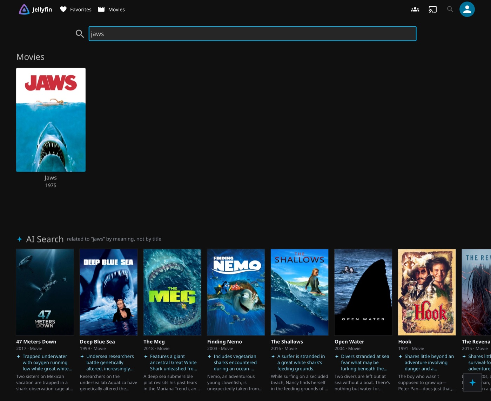
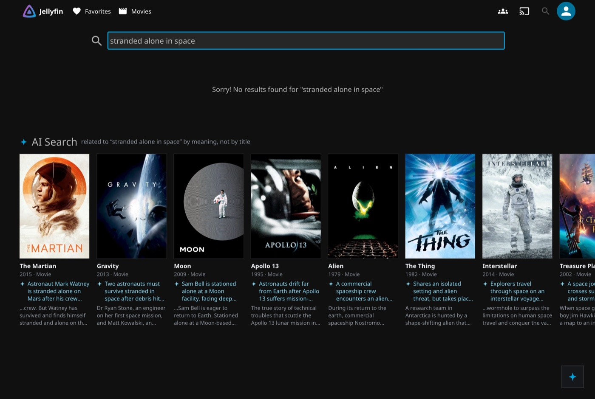
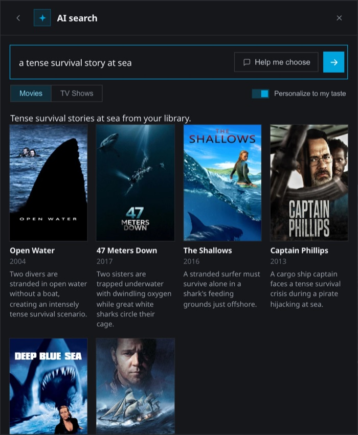
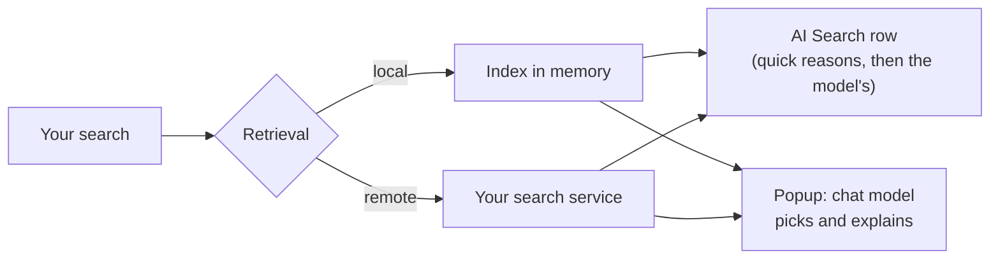

# AI Search for Jellyfin

Search your Jellyfin library by describing what you want instead of typing a title. "Something
tense at sea", "the Kaamelott episode with the Grail", "a feel-good 90s comedy". The plugin finds
the titles in your library that fit, and tells you why each one came up.

It works in two places:

- **Jellyfin's own search.** Title matches show up as usual, and right below them an "AI Search"
  row lists the titles that match what you meant, even when their title has none of your words.
- **An AI search button** in the web client. You describe what you feel like watching, and a
  language model picks from your library and writes a line about each pick.

`Jellyfin 12.0+` · `.NET 10` · `no database` · `any OpenAI-compatible endpoint` · `runs fully offline with Ollama`

Versions 1.2.0.0 and later need Jellyfin 12.0 or newer. Jellyfin 10.11 servers keep getting
1.1.1.0 from the catalog, Jellyfin picks the version that matches the server.

## What it looks like

Searching "jaws". Jellyfin finds the film by its title. The AI Search row underneath finds the
other shark films, and each card says why it is there.



When no title matches at all, Jellyfin says so and the row still has answers.



The AI search button opens a popup for longer requests. Here the model picked six films from the
library and wrote a reason for each.



These screenshots come from a small test library of 35 films. More from a real library are at the
[bottom of this page](#screens).

## How it works

Every movie, show and episode gets turned into an embedding: a list of numbers that captures what
the title is about, built from its name, genres, tags, cast and synopsis. An embedding model does
this once for the whole library, then again each night for whatever changed. The result is a
single file in Jellyfin's data folder.

When you search, your words go through the same model, and the plugin compares them with every
title in the library to find the closest ones. There is no vector database. Comparing a search
with 18,000 titles takes about 2 ms, so a plain scan is enough.

What happens next depends on where you searched.

**On Jellyfin's search page**, the closest titles go into the AI Search row. Titles Jellyfin
already found by name are left out, so nothing shows twice. Each card first gets a quick reason:
which of your words appear in its synopsis, genres, tags, cast or title. If you set up a chat
model, it then writes a short sentence for each card a few seconds later and replaces the quick
one. Jellyfin's own results never wait for any of this, because the row is loaded separately.

**In the popup**, the 40 closest titles go to the chat model with their cast and synopsis, plus
your favorites and watch history if you want it personal. The model picks the best ones and
explains each pick. It can only answer with numbers from that list, so it cannot invent a film
you don't have, or one you are not allowed to see.

If you already run a service that indexes your library, the plugin can ask it for matches instead
of keeping its own index. See [Remote retrieval](#remote-retrieval).



### Why an index

The first version of this plugin sent a list of titles to the model and asked it to choose. That
limits what it can find. If you have 3000 movies but only send the 300 best rated, the model never
gets a chance to recommend the other 2700. With an index, the whole library is searched every
time, and the model only gets the 40 titles that are actually close to what you asked.

### The popup, step by step

1. The client script calls the plugin with your existing Jellyfin session. No API key and no
   endpoint URL ever reach the browser.
2. The local index or the remote service returns the closest titles.
3. The plugin drops titles you cannot access, titles already shown, and watched titles unless
   you asked to include them.
4. Each remaining title becomes one line for the model: `index | title (year) | genres | cast | synopsis`.
5. The model answers in JSON and picks by index only.
6. The plugin maps the picks back to your library and shows posters, titles, years and reasons.

If the index or the search service is down, the plugin sends a slice of the library instead. If
the model refuses `response_format`, it tries again without it, and it copes with JSON wrapped in
Markdown code fences.

### Design decisions

| Decision | Reason |
|---|---|
| Brute-force scan, no vector database | A search against 18,000 vectors takes about 2 ms. A database would add setup and upkeep for nothing at this size. |
| One contiguous matrix, SIMD dot products | Uses `System.Numerics.Vector`, which ships with .NET, so there is no extra dependency. About 6 times faster than the first version's plain loop. |
| Vectors normalized once, at index time | Cosine similarity becomes a dot product. A search does no division. |
| One binary file in Jellyfin's data folder | The index loads at startup and survives a restart without re-embedding anything. |
| Immutable snapshot, swapped in one step | A rebuild replaces one reference. Searches keep using the old index until the new one is ready. |
| SHA-256 hash per title | The nightly build only re-embeds titles whose metadata changed. |
| The hash covers the model id and the prefix | Switch embedding models and every vector is rebuilt on the next run. Vectors from two models never mix. |
| The model picks by index | It cannot invent a title, or return one the user may not see, because the list comes from that user's own library. |
| Search answers are cached and shared | Retyping a search, or two people searching the same thing, costs one call to the embedding service. |

Index file format (v1):

```
"AISEARCH" | version | model | built-at ticks | dimensions | count
then per entry: item GUID (16 B) | content hash | float32 × dimensions
```

The file is written to a temporary path and then renamed, so a save that gets interrupted cannot
break the current index.

## Measured on a real library

3000 movies and 15000 episodes, mostly with French metadata.

| | |
|---|---|
| Index size | about 100 MB, one file |
| Comparing a search with every title | about 2 ms |
| Jellyfin search in the web client | about 0.1-0.25 s, same as without the plugin |
| AI Search row | about 40-170 ms, the model's reasons about 3-4 s later |
| AI popup with the model off | about 0.1-0.3 s (the model call comes on top when it is on) |
| First build, Ollama + bge-m3 on CPU | about 40 minutes |
| First build, OpenAI `text-embedding-3-small` | a few minutes, about $0.05 |
| Nightly build | about 1 minute, usually nothing to re-embed |
| Tokens per popup search | about 7000 input, for 40 candidates with synopsis |
| Cost per popup search, `mistral-medium` | about $0.01 |
| Cost with local Ollama | none |

## Features

| Feature | What it does |
|---|---|
| **AI Search row** | Below Jellyfin's search results, the titles that match the meaning of your search, each with a reason. |
| **Search** | Free-text query in the popup. Works on mood, theme, plot, cast or director. |
| **Surprise me** | No query. The model gets a random slice of the library and, if personalization is on, your favorites and history. Good for finding something you would never have searched for. |
| **Help me choose** | The model reads what you typed and asks 2 or 3 multiple-choice questions to narrow it down. With an empty box you get generic questions on mood, length and whether you have seen it. |
| **Create collection** | Saves the results as a Jellyfin playlist. Any result set can also be saved afterwards. |
| **History** | Your last 12 popup searches, kept on the server. Reopen the results or run the search again. |
| **Movies / TV switch** | Searches series and single episodes. If you name a series you own, only that series is searched. |
| **Personalize** | Adds your favorites, watch history and taste profile to the prompt. Turn it off for a neutral search. |
| **Taste profile** | The model sums up your taste in 2 to 4 sentences. It refreshes after 7 days or when your viewing changes, and stays on your server. |
| **Retrieval only** | Turn the language model off and get the closest titles ranked by similarity, with no model call. |
| **French or English** | The plugin follows each user's Jellyfin language, or a language you choose for everybody. The model writes its reasons in that language too. |

## Jellyfin search integration

The plugin registers as one of Jellyfin's own search providers, next to the built-in title
search. It needs a retrieval source (local index or remote service) but no language model, and it
keeps working with **Native search only** turned on.

### In the web client

Jellyfin only shows search results once every search provider has answered. If the plugin added
its matches to that answer, a slow embedding service would hold back the title results too. So
in the web client it doesn't. The client script marks its search requests, the plugin skips them,
and Jellyfin's results come back as fast as without the plugin. The script then asks the plugin
for the meaning matches on its own (`GET /AiSearch/Matches`) and shows them in the AI Search row.

- The row always sits below Jellyfin's own rows, and shows up for every search that has meaning
  matches.
- Titles Jellyfin already found by name are not repeated in the row.
- The quick reason is built from the words of your search found in the title, synopsis, genres,
  tags, cast, studio or series name. Accents and plurals don't matter. When nothing matches word
  for word, which is common when you search in another language than your metadata, it just says
  the title is close in meaning.
- With a chat model set up, the plugin asks it once per finished search for a one-line reason per
  title (`POST /AiSearch/Explain`). Those replace the quick reasons in place, without moving the
  cards.
- Turn the row off and the matches are mixed into Jellyfin's rows instead, like in other apps.

### In other apps

TV and mobile apps can't show an extra row, so they get the meaning matches mixed into Jellyfin's
results. Those matches always score below Jellyfin's lowest title match (1 to 49, against 50 and
up), so they come after the title matches in each section. To keep searches quick, the plugin
waits at most 2 seconds for them (adjustable). A slower answer isn't wasted: it finishes in the
background and the next search gets it straight away.

These responses also carry two headers: `X-AiSearch-Matches` lists the ids only the meaning search
found, and `Server-Timing: aisearch;dur=...` shows how long the plugin took.

### Speed

- Searches are cached and shared. Retyping a term, going back to a previous search, or two people
  searching the same thing at once all cost a single call to the embedding service.
- Embedding servers like Ollama unload a model that has been idle for a few minutes, and loading it
  again takes a second or two. The web client warns the server when you open the search page or
  the popup (`POST /AiSearch/Warmup`), so the model is loaded by the time you have typed something.
  Nothing happens if it was used in the last three minutes.

### Access control

- Each match is loaded through the user's own library view and checked with Jellyfin's usual
  visibility and parental rules (`BaseItem.IsVisibleStandalone`) before it is shown.
- The search's own type filters (`includeItemTypes`, `excludeItemTypes`, `mediaTypes`) and
  `parentId` are respected. Only movies, series and episodes are matched.

### Options

**Dashboard → Plugins → AI Search**, section "4. Jellyfin search":

| Option | Default | Effect |
|---|---|---|
| Add meaning-based matches to Jellyfin's search | On | Turns the feature on or off. |
| Only for searches that look like a sentence | Off | Skips short keyword searches (see the minimum word count below). |
| Minimum words to run | 3 | Only used when the option above is on. |
| Max meaning-based matches per search | 20 | How many titles the plugin adds to one search. |
| Longest wait for meaning-based matches in other apps (ms) | 2000 | 250-10000. How long a search from a TV or mobile app may wait. |
| Show meaning-based matches in their own "AI Search" row | On | The web client row. Off mixes the matches into Jellyfin's rows. |
| Explain each AI Search result with the language model | On | Needs the chat model from section 1. Off keeps the quick reasons. |
| Language of the AI Search interface | Auto | Auto follows each user's Jellyfin language, then the browser's. Français or English forces one for everybody, including the model's reasons. |
| Native search only | Off | See below. |

### Native search only

This hides the AI search button and popup, and leaves Jellyfin's own search (with the AI Search
row, if it is on) as the only way to search.

- The client script stays loaded only for the AI Search row and shows no button. With the row off
  too, `index.html` is served without the script tag, and a copy left over from before is removed.
- These popup-only endpoints answer with an empty 404: `Models`, `Recommend`, `Interview`,
  `History` (GET and DELETE), `Playlist`.
- These keep working, since the dashboard or Jellyfin's search need them: `ClientScript`,
  `Health`, `Warmup`, `Matches`, `Explain`, `EmbeddingModels`, `IndexStatus`, `RebuildIndex`,
  `SearchLog`.

## Search log

Turned off by default. When **Log searches** is on, the plugin records every native Jellyfin
search (from the filter above, whenever a request carries a non-empty `searchTerm`) and every AI
popup search to a local, line-delimited JSON file, one compact JSON object per line, for an
external collector or another admin tool to read.

- Files live at `{Jellyfin data folder}/aisearch/searchlog/{yyyy-MM-dd}.jsonl` (UTC date), one
  file per day.
- **Keep logs for (days)** (default 7, 1-365) controls retention: files older than that are
  deleted at startup and every hour after.
- Recorded per entry: a strictly increasing id, the request timestamp/endpoint/method/status/
  duration, the search term, the caller's user id/name, whether it was an API key, client name/
  version/device, remote address and User-Agent, every other query parameter (with anything that
  looks like a credential - API key, token, auth, password - left out), the `parentId` scope if
  any, result counts, and up to 250 result rows (item id, name, type, year, series/season/episode,
  its `origin` (`title`, `semantic` or `both`) with the semantic similarity and rank, and, for AI
  popup entries, the model's one-line reason). Native search entries also carry the plugin's
  timing split (`backendMs`, `scanMs`, `lookupMs`, `cached`). AI popup entries also carry the mode
  (`normal`/`surprise`) and the model's answer text. Files are plain UTF-8 without a byte-order mark.

**`GET /AiSearch/SearchLog`** (admin only) reads it back:

| Query parameter | Meaning |
|---|---|
| `from` | Inclusive lower timestamp bound (ISO 8601, UTC). Omit for unbounded. |
| `to` | Exclusive upper timestamp bound (ISO 8601, UTC). Omit for unbounded. |
| `afterId` | Only return entries with an id greater than this, for paging. |
| `limit` | Max entries to return, 1-5000, default 1000. |

```jsonc
// response
{
  "entries": [ /* the stored JSON objects, unchanged */ ],
  "hasMore": false,
  "nextAfterId": 12345,        // id of the last entry returned, or null if entries is empty
  "loggingEnabled": true,
  "retentionDays": 7,
  "oldestTimestamp": "2026-09-12T00:00:00.000Z"  // or null if no log files exist
}
```

To page through everything: call once with no `afterId`, then repeat with `afterId` set to the
previous response's `nextAfterId` until `hasMore` is `false`.

## Install

Add the repository in **Dashboard → Plugins → Repositories**:

```
https://raw.githubusercontent.com/Franciskid/jellyfin-plugin-ai-search/main/manifest.json
```

Install **AI Search** from the catalog, restart Jellyfin, then open **Dashboard → Plugins → AI Search**.

## Configure

Choose a chat service to make recommendations and a search source to find matching titles.

### Fully local, with Ollama

```
Chat endpoint URL:    http://<ollama-host>:11434/v1/chat/completions
Chat API key:         (empty)
Models endpoint URL:  http://<ollama-host>:11434/v1/models
Model:                any chat model from the dropdown
Retrieval:            Local index
Embeddings endpoint:  http://<ollama-host>:11434/v1/embeddings
Embedding model:      bge-m3          (run "ollama pull bge-m3" first)
```

Save, then click **Build index now**. Nothing leaves your network.

### OpenAI

```
Chat endpoint URL:    https://api.openai.com/v1/chat/completions
Chat API key:         sk-...
Models endpoint URL:  https://api.openai.com/v1/models
Model:                gpt-4o-mini
Retrieval:            Local index
Embeddings endpoint:  https://api.openai.com/v1/embeddings
Embedding model:      text-embedding-3-small
```

OpenAI receives title metadata when the index is built. During a search, it also receives your
query and the metadata of the selected candidates, plus favorites and history if personalization
is enabled.

### Chat-only providers

If your chat provider does not offer embeddings, you can use a local Ollama instance for those.
Set the chat endpoint to your provider and the embeddings endpoint to Ollama. The chat provider
still receives your search prompt and candidate metadata.

### Remote retrieval

```
Chat endpoint URL:    https://ai.your-service.example/api/media/chat
Models endpoint URL:  https://ai.your-service.example/api/media/models
Retrieval:            Remote service
Search endpoint URL:  https://ai.your-service.example/api/media/search
Search API key:       (issued by your service)
```

The service maintains the index and returns matching titles. The plugin then calls the language
model and checks the results against the user's library. Use this when a service already indexes your library, or
when you need to cap usage per user centrally. The contract is at the bottom of this file.

### Which embedding model

- **Multilingual libraries:** `bge-m3` on Ollama, about 1.2 GB. Multilingual, no prefix configuration.
- **English only, hosted:** `text-embedding-3-small`. A low-cost hosted option.
- **`nomic-embed-text`:** works, but you must fill in the prefixes on the config page: query prefix
  `search_query: ` and document prefix `search_document: `. Missing prefixes can lead to poor results without an error message.

## Options

**Language model**

| Option | Effect |
|---|---|
| Enable AI search | Turns the feature on or off. Turning it off also hides the search bar. |
| Use a language model | Off: return retrieval matches ranked by similarity, with no reasons. No chat endpoint is then required. |
| Chat endpoint URL | An OpenAI-compatible chat-completions URL. Used verbatim. |
| Chat API key | Bearer key. Leave empty if the endpoint needs none. |
| Model | The model that chooses titles and explains its choices. Save the URL first, then reload the dropdown. |
| Models endpoint URL | Lists models for the dropdown. Optional. OpenAI, bare-array and Ollama shapes are all accepted. |
| "Help me choose" model | Optional separate model for the follow-up questions. |
| Reply length limit field | Automatic by default: sends `max_tokens`, and switches to `max_completion_tokens` when the model refuses it, like newer OpenAI models do. It also stops sending `temperature` to models that only accept the default. You can force either field, or send no limit. |

**Retrieval**

| Option | Effect |
|---|---|
| Retrieval source | Local index, or remote service. |
| Search endpoint URL / key | Remote only. Returns ranked candidates. |
| Embeddings endpoint URL / key | Local only. An OpenAI-compatible `/v1/embeddings` URL. Empty disables the index. |
| Embedding model | Local only. Loaded into a dropdown from the embedding models endpoint. |
| Also index TV shows & episodes | Local only. Embeds every series and every episode. The first build takes a while. |
| Query / document prefix | Local only. For models that require them. Leave empty for bge-m3. |
| Build index now | Builds or refreshes the index. The status line shows progress and the last error verbatim. |

**Fallback, used until the index exists**

| Option | Effect |
|---|---|
| Candidate titles sent to the model | Size of the catalog slice. Default 350. |
| How candidates are chosen | Top rated, random sample, or half of each. |

**Shared**

| Option | Effect |
|---|---|
| Libraries AI Search ignores | Ticked libraries are left out of the index, the popup and the AI matches in Jellyfin's search. Their titles still show up in Jellyfin's normal title search. |
| Candidates retrieved per query | How many candidates the model chooses from. Default 40, maximum 200. More candidates give the model more choice, but take longer and can cost more. |
| Max results | How many recommendations come back. |
| Include titles you already watched | Off by default. |
| Request timeout | Seconds before the backend call is abandoned. Default 45. |

**Jellyfin search** (see [Jellyfin search integration](#jellyfin-search-integration) above)

| Option | Default | Effect |
|---|---|---|
| Add meaning-based matches to Jellyfin's search | On | Uses the retrieval source above; no language model needed. |
| Only for searches that look like a sentence | Off | Skips short keyword-style searches. |
| Minimum words to run | 3 | Only checked when the option above is on. |
| Max meaning-based matches per search | 20 | Upper bound per search. |
| Longest wait for meaning-based matches in other apps (ms) | 2000 | How long a TV/mobile app search may wait on the backend. |
| Show meaning-based matches in their own "AI Search" row | On | Web client row under Jellyfin's results. |
| Explain each AI Search result with the language model | On | One-line reason per result, from the chat model. |
| Language of the AI Search interface | Auto | Auto (Jellyfin display language, then browser), Français or English. |
| Native search only | Off | Hides the AI search bar/popup and its endpoints. |

**Search log** (see [Search log](#search-log) above)

| Option | Default | Effect |
|---|---|---|
| Log searches | Off | Records native and AI popup searches to a local file. |
| Keep logs for (days) | 7 | 1-365. Older files are deleted at startup and hourly. |

## HTTP API

| Endpoint | Auth | Purpose | Native search only |
|---|---|---|---|
| `POST /AiSearch/Recommend` | Session | Run a search for the calling user | Refused (404) |
| `POST /AiSearch/Interview` | Session | Model-written questions for "Help me choose" | Refused (404) |
| `GET /AiSearch/History` | Session | The caller's recent searches | Refused (404) |
| `DELETE /AiSearch/History[/{id}]` | Session | Delete one search, or clear all | Refused (404) |
| `POST /AiSearch/Playlist` | Session | Save a result set as a playlist | Refused (404) |
| `GET /AiSearch/Health` | Session | Enabled, configured, popup and AI row state, for the client script | Reachable |
| `POST /AiSearch/Warmup` | Session | Load a cold retrieval backend before the user's query | Reachable |
| `GET /AiSearch/Matches?term=` | Session | Meaning matches for the AI Search row, with instant reasons (`parentId`, `locale` optional) | Reachable |
| `POST /AiSearch/Explain` | Session | Model-written reason per matched title (`term`, `itemIds`, `locale`) | Reachable |
| `GET /AiSearch/ClientScript` | none | The injected UI script. Contains no secrets. | Reachable |
| `GET /AiSearch/Models` | Admin | Chat models, proxied from the models endpoint | Refused (404) |
| `GET /AiSearch/EmbeddingModels` | Admin | Embedding models, for the config dropdown | Reachable |
| `GET /AiSearch/IndexStatus` | Admin | Index size, model, last build, last error | Reachable |
| `POST /AiSearch/RebuildIndex` | Admin | Start a background build. Only one build runs at a time. | Reachable |
| `GET /AiSearch/SearchLog` | Admin | Page through the search log (see [Search log](#search-log)) | Reachable |

`Recommend` accepts `mode` (`normal` or `surprise`), `scope` (`movies` or `tv`), `locale`,
`personalize`, a per-request `includeWatched`, and `excludeItemIds`. The "show more" button sends
the ids it already displayed. Those follow-up calls reuse the first call's conversation id and are
not recorded in history.

### Remote retrieval contract

Three endpoints, each a full URL, each authenticated with a bearer key.

**Search** (required). `POST {SearchEndpointUrl}` returns ranked candidates and makes no model call.

```jsonc
// request
{
  "query": "a slow-burn western",
  "scope": "movies",                   // or "tv"
  "maxResults": 40,
  "includeWatched": false,
  "excludeItemIds": ["<id>", "..."],
  "user": { "id": "<jellyfin-user-guid>", "name": "<username>" }
}
// response
{
  "model": "embedding-model-used",
  "retrieved": 40,
  "results": [
    { "itemId": "<jellyfin-item-guid>", "title": "...", "year": 2017,
      "mediaType": "movie", "genres": ["..."], "overview": "...", "score": 0.55 }
  ]
}
```

Only `itemId` is required. The plugin checks the returned ids against the user's own library,
so a remote service cannot grant access to other content.

**Chat** (required). `POST {ChatEndpointUrl}`, a standard chat completion. Any
`/v1/chat/completions` fits.

**Models** (optional). `GET {ModelsEndpointUrl}` returns `{ "data": [{ "id": "..." }] }`. The
embedding dropdown may add `?capability=embedding` when the service supports it.

## Privacy and cost

- Endpoint URLs and API keys stay in the server-side plugin configuration. The web client never
  sees them.
- For each search, the chat service receives your prompt and the title, year, genres, cast and a
  short synopsis for about 40 candidates. With personalization enabled, it also receives favorites
  and watch history as title lists, along with your taste profile.
- During an index build, the embedding service receives the metadata for each title that needs
  a new embedding.
- If both services use local Ollama, this data stays on your network.
- History and taste profiles are JSON files under Jellyfin's data folder, one per user.

## Troubleshooting

| Symptom | Cause and fix |
|---|---|
| "No models returned" | Save the URL and key first, then reload the dropdown. |
| Index stays at 0 | Read the status line under "Build index now". It shows the last error verbatim. The scheduled task log holds the same information. |
| Results feel random | The plugin may be searching without an index. Build the index and check for errors. With nomic, also check the prefixes. |
| Index build fails with "returned empty (null or NaN) values" | The model behind the embeddings endpoint is not an embedding model. A reranker such as `bge-reranker-v2-m3`, or llama.cpp started with `--pooling rank`, gives no embeddings. Use an embedding model (`bge-m3`, `nomic-embed-text`, `embeddinggemma`) with `--embedding --pooling mean`. If only a few titles fail, the build skips them and says how many. |
| Chat endpoint returns "Unsupported parameter: 'max_tokens'" | Fixed in 1.3.0.1: the plugin switches to `max_completion_tokens` by itself. Or set "Reply length limit field" to `max_completion_tokens`. |
| Ollama returns 500 on embeddings, but short strings work | Seen on a GTX 1660 SUPER: bge-m3 returned NaN vectors on the GPU. Run the embedding model on CPU: `printf 'FROM bge-m3\nPARAMETER num_gpu 0\n' \| ollama create bge-m3-cpu -f -` |
| Search page jumps or the AI Search row never shows | Hard-refresh the page after updating the plugin, so the browser loads the new script. |
| Search bar missing | The plugin adds one script tag to the web client's `index.html` as Jellyfin serves it, so nothing on disk has to be writable. Check the log for `AiSearch:` lines and hard-refresh the browser. A web client served by something other than Jellyfin needs the tag by hand: `<script src="/AiSearch/ClientScript" defer></script>` |

## Limits

- The index holds one vector per title. Each synopsis is represented by one set of numbers, so very
  specific plot details can be missed.
- Episode search needs the TV index. Until it is built, TV search uses a smaller selection from the library.
- History keeps 12 entries per user.
- The client script is injected into the shipped web client. A custom or externally hosted web
  client needs the script tag added by hand.

## Compatibility

Versions 1.2.0.0 and later need Jellyfin **12.0 or newer** (`targetAbi 12.0.0.0`), .NET 10. The
plugin builds against the 12.0.0 package, so the same DLL loads on every 12.0.x and 12.1.x server
so far.

Jellyfin **10.11** servers keep getting 1.1.1.0 (`targetAbi 10.11.0.0`, .NET 9). The catalog lists
both versions and Jellyfin installs the one that matches the server.

## Screens

From a real library of about 3000 films, in the AI search popup.

**Theme query.** "american movie about american frontier"


**Cast query.** One title matches, so one title comes back.


**Episode search.** "south park episode with cartman managing a park"


**Surprise me.** A varied mix from across the library.


**One reason per result.**


## License

Developed by [Franciskid](https://github.com/Franciskid). Licensed under the [GPL-3.0](LICENSE),
like most Jellyfin plugins.
